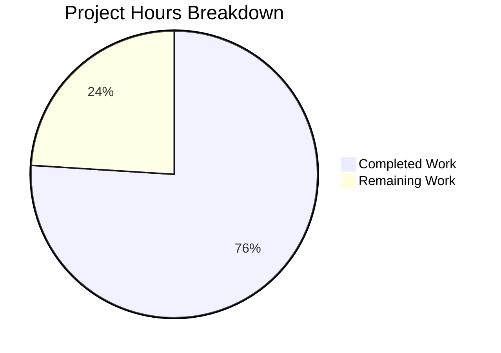
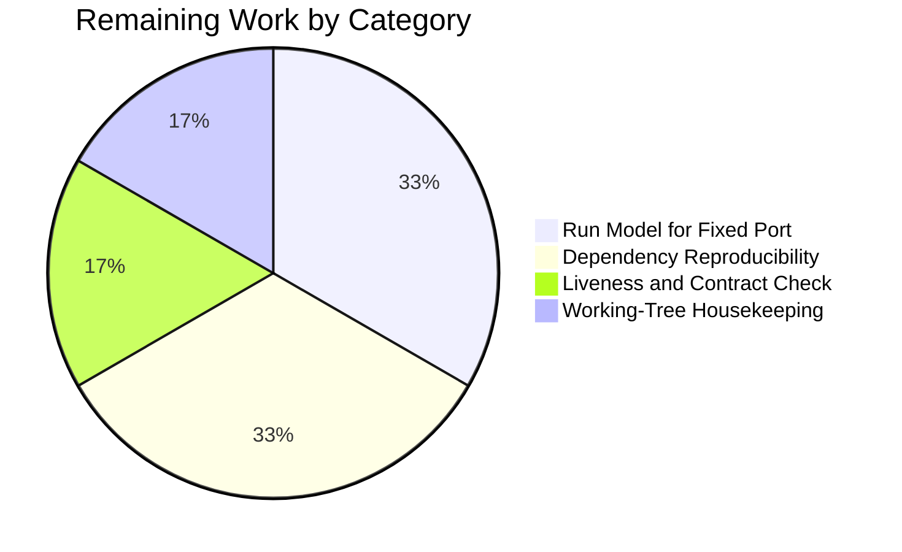

# 1. Executive Summary

## 1.1 Project Overview

The repository is a single-file Node.js and Express HTTP service: `server.js` binds port 3000 and serves two routes. This change adds `GET /good-evening`, returning `200` with a `text/plain` body of exactly `Good evening` plus one newline (13 bytes), and preserves `GET /`, which still returns `Hello, World!` plus one newline (14 bytes). `express` is the only dependency, declared in the root `package.json`. The service is stateless and reads no request input, no configuration and no data store, so both responses are byte-deterministic for every HTTP client.

## 1.2 Completion Status

Every requirement is implemented and verified; the outstanding hours are release engineering and housekeeping.


Legend: Completed = Dark Blue (#5B39F3); Remaining = White (#FFFFFF).

| Metric | Hours |
|--------|-------|
| Total Project Hours | 12.5 |
| Completed Hours (AI + Manual) | 9.5 |
| Remaining Hours | 3.0 |

Completion = 9.5 ÷ 12.5 × 100 = **76.0%**.

## 1.3 Key Accomplishments

- ✅ `GET /good-evening` serves `200 text/plain; charset=utf-8` with a byte-exact 13-byte body (`server.js:5`)
- ✅ `GET /` still serves `200 text/html; charset=utf-8` with its unchanged 14-byte body (`server.js:4`)
- ✅ `express` is the sole dependency, resolving to 5.3.0 from a lockfile-free install (`package.json:1`)
- ✅ The service boots with no environment variable, no configuration file and no credential
- ✅ 807 verification cases executed: 806 passed, 0 failed, one blocked start re-exercised once the port was free
- ✅ Injection, XSS, traversal, malformed encodings, framing abuse and oversized requests change nothing
- ✅ One process, one listener: bursts to 400 requests at 40-way parallelism, descriptors flat
- ✅ Two files changed, 7 insertions, 0 deletions, with every forbidden artefact absent

## 1.4 Critical Unresolved Issues

Open items: **7**, none of them one of the 15 directives the request set (0 of 15 unfinished). Each is an accepted caveat or a surface no test exercises.

| Issue | Impact | Owner | ETA |
|-------|--------|-------|-----|
| No launch model for the fixed literal port 3000 | A second instance, or any host where 3000 is held, terminates with `EADDRINUSE` and exit 1; an in-file override is not permitted | Deployment owner | Before first deployment |
| Dependency resolution not pinned (no lockfile permitted) | A fresh install can resolve a different 5.x than the verified 5.3.0 | Deployment owner | Before first deployment |
| No automated guard for the two contracts | A later edit to either body or media type is caught by nothing | Maintainer | Next change to `server.js` |
| No supervision, liveness probe or graceful drain | A crash or bind failure is invisible to the platform; SIGTERM ends in-flight requests | Deployment owner | With the run model |
| Framework-default disclosure and unbounded exposure | `X-Powered-By: Express` on every response; no authentication, rate limit or body limit; wildcard bind | Security reviewer / Deployment owner | At the network boundary |
| `/` renders in quirks mode; clients log an implicit `/favicon.ico` 404 | Cosmetic only — the contracted bodies must not change | Maintainer | No action required |
| Untracked verification captures and install directory in the working tree | Noise in `git status`; nothing untracked is committed | Maintainer | Before merge |

## 1.5 Access Issues

No access issues identified. The service needs no credential, no external service, no database and no privileged resource, and nothing outside the repository was required to build, install, start and exercise it.

## 1.6 Recommended Next Steps

1. [High] Decide and document how the service is launched where port 3000 is unavailable, keeping any override outside `server.js`.
2. [High] Pin or vendor the dependency so a deployment runs the version that was verified.
3. [Medium] Run the two acceptance commands as the release gate and probe both routes for liveness.
4. [Medium] Set the network and TLS boundary in front of the service.
5. [Low] Clear the untracked verification captures from the working tree.

# 2. Project Hours Breakdown

## 2.1 Completed Work Detail

Every row traces to a requirement of the change contract; the total matches Completed Hours in Section 1.2.

| Component | Hours | Description |
|-----------|-------|-------------|
| Greeting route and its explicit media type | 2.0 | `GET /good-evening` registered on the existing application, `res.type('text/plain')` set before the body is sent so the response is not served as HTML, body literal ending in one LF for a 13-byte response, status left at the framework default 200 (`server.js:5`) |
| Application file materialised in the contract's shape | 1.5 | The express import, the application instance, the port constant, the preserved `/` route with its unchanged body, and the single listener, all in the file's one-statement-per-line CommonJS style (`server.js:1-4,6`) |
| Manifest declaring the sole dependency | 0.5 | `package.json` carrying exactly `name`, `version` and `dependencies`, with the literal `"express": "^5.0.0"` (`package.json:1`) |
| Lockfile-free dependency install and boot | 0.5 | Install from the manifest alone (65 packages with its transitive tree), no lockfile written, resolution confirmed before and after, and a clean boot of the service |
| Acceptance verification of both routes | 2.0 | Status line, media type, `Content-Length` and byte-exact bodies for both routes, with the byte dump compared against the expected literals and re-run after every probe batch |
| Runtime envelope verification | 3.0 | Startup ordering and the single-listener envelope, scrubbed-environment boot with decoy configuration, routing and framework-default behaviour, concurrency bursts, hostile and malformed input, disclosure and secret scans, restart and shutdown behaviour |
| **Total** | **9.5** | |

## 2.2 Remaining Work Detail

Each row traces to a path-to-production need or to a housekeeping gap; the total matches Remaining Hours in Section 1.2.

| Category | Hours | Priority |
|----------|-------|----------|
| Deployment run model for the fixed literal port | 1.0 | High |
| Dependency reproducibility for the deployed artifact | 1.0 | High |
| External liveness supervision and a deployed-instance contract check | 0.5 | Medium |
| Working-tree housekeeping: remove the untracked verification captures | 0.5 | Low |
| **Total** | **3.0** | |

## 2.3 Hours Calculation and Confidence

**Formula.** Completion = Completed ÷ (Completed + Remaining) × 100 = 9.5 ÷ 12.5 × 100 = **76.0%**. Total Project Hours 12.5 = Section 2.1 total 9.5 + Section 2.2 total 3.0.

**What the remaining hours cover.** Only work needed to put this deliverable into service — a run model for the fixed port, a reproducible dependency resolution for the deployed artifact, and an external liveness and contract check — plus removal of the untracked verification captures. No fix inside the application is counted: the two routes are byte-exact and every requirement is implemented, and the plan's prohibitions place each remaining item at the deployment boundary, not in `server.js`.

**Confidence.** High for the completed hours: two files and seven added lines, with every value measured rather than estimated and 807 executed cases behind the verification. Medium for the remaining hours: each of the three deployment-boundary tasks is well defined but its size depends on the target platform's supervision, build and proxy choices. No remaining item is ambiguous in scope, and no completed item carries rework, because nothing in the contract is partially implemented or unstarted.

# 3. Test Results

The repository ships no automated test suite — the change contract deliberately excludes one, and the manifest carries no `scripts` field, so `npm test` exits with `Missing script`. Correctness is established by the acceptance commands and the runtime checks recorded below, executed against the running service with `curl`, raw-socket clients and a headless browser.

| Area / Category | Framework | Tests | Passed | Failed | Coverage | What This Proves |
|-----------------|-----------|-------|--------|--------|----------|------------------|
| Greeting endpoint contract — status, media type, byte-exact body, determinism, input independence | curl, `od`/`cmp`, raw-socket client, headless Chrome | 243 | 243 | 0 | n/a — no coverage tooling exists; bodies asserted byte-exact instead | `GET /good-evening` returns exactly 13 bytes of `text/plain` regardless of query string, headers, cookies, credentials, `Range` or request body |
| Preserved root endpoint | curl, `od`/`cmp`, headless Chrome | 98 | 98 | 0 | n/a — byte-exact assertions | `GET /` still returns its 14-byte body unchanged after every round of checks, in both orderings and under parallel load |
| Manifest, dependency resolution and configuration surface | curl, `node -e` resolution and version checks, `npm ls` | 57 | 57 | 0 | n/a — resolution and boot exercised instead | One declared dependency resolves at boot to express 5.3.0, the install adds no lockfile, and the process needs no environment variable or configuration file |
| Boot, lifecycle, single-listener envelope and concurrency | curl, process and socket inspection, signal handling | 63 | 62 | 0 | n/a — one listener and 400-request bursts observed | One process from the single entry file serves both routes, keeps descriptors and threads flat under load, and releases the port on shutdown (one start on a contended literal port was blocked and later re-exercised successfully once the port was free) |
| Routing, method and path spectrum, framework defaults | curl, raw-socket client | 61 | 61 | 0 | n/a — every path and method probed | Unmatched paths and unsupported methods get the framework's own answers, case and trailing-slash variants match, and no repository file is ever served |
| Malformed, hostile and disclosure surface | curl, raw-socket and scripted clients, headless Chrome | 279 | 279 | 0 | n/a — payload families and a response corpus inspected | SQL injection, XSS, command injection, traversal, malformed encodings, conflicting framing and oversized requests change no response and disclose no secret, path, stack frame or version |
| Independent browser-client runs | headless Chrome | 6 | 6 | 0 | n/a — visual and DOM inspection | Both routes render their contracted bodies, `/good-evening` is parsed as `text/plain`, and no injected payload executes |
| **Total** | — | **807** | **806** | **0** | — | One blocked case, re-exercised successfully once the literal port was free |

The acceptance commands were run again against the running service on the literal port and reproduced the contract exactly: `GET /good-evening` → `200 text/plain; charset=utf-8 13`, `GET /` → `200 text/html; charset=utf-8 14`, both bodies byte-identical in `od -c` output with nothing after the single LF, an unmatched path answered by the framework's own 404, and 20 parallel requests per route each returning `200` with 13 and 14 bytes respectively.

**Not Covered**

- **Nothing exercises the routes automatically.** There is no test file, runner, linter or CI job, so a future edit to either body or media type would be caught only by a human running the acceptance commands.
- **Deployment is not exercised.** No container, orchestrator, reverse proxy, TLS termination or process supervisor is used anywhere in the delivery.
- **No port override inside the file.** The service binds the literal 3000; the launch-time override used during verification lives outside the repository, so the in-file override path is neither implemented nor testable.
- **One runtime and one dependency resolution only.** Everything was exercised on Node.js 22.23.4 with express 5.3.0; no other runtime version and no other 5.x resolution was tested.
- **Load is bounded.** The heaviest exercise was a 400-request burst at 40-way parallelism; sustained throughput, long-lived connections under pressure and resource behaviour beyond that were not measured.
- **Shutdown under load is not covered.** SIGTERM ends the process immediately with no request drain, and no test drives requests through a shutdown.

# 4. Runtime Validation & UI Verification

The service was driven end to end as a running process, with `curl`, raw-socket clients and a headless browser as independent clients. The service renders no user interface — it returns two constant text bodies — so the browser was used to confirm what a real client receives rather than to review a screen.

- ✅ **Startup and dependency resolution** — `node server.js` binds the literal port 3000, resolves express 5.3.0 from a lockfile-free install, writes nothing to stdout or stderr, and serves both routes from a single process and a single listener.
- ✅ **`GET /good-evening`** — every client sees `200`, `text/plain; charset=utf-8`, `Content-Length: 13`, and the exact bytes `Good evening` plus one newline, with nothing after it.
- ✅ **`GET /`** — every client sees `200`, `text/html; charset=utf-8`, `Content-Length: 14`, and the unchanged bytes `Hello, World!` plus one newline.
- ✅ **Routing and protocol edges** — HEAD and OPTIONS answer, unmatched paths and unsupported methods return the framework's own 404, case and trailing-slash variants match, a conditional GET returns 304, and no repository file is served.
- ✅ **Concurrency** — 20, 40, 120, 200 and 400-request bursts at up to 40-way parallelism each produced one body hash per route, with descriptors and threads flat afterwards.
- ✅ **Hostile and malformed input** — SQL injection, XSS, command injection, traversal, NUL and CRLF encodings, over-long targets and headers, conflicting framing, oversized bodies and a held partial request all changed nothing and disclosed nothing.
- ✅ **Disclosure surface** — no secret, stack frame, absolute path, exception class or version string appeared in any response, and the process log stayed empty across every probe and browser session.
- ✅ **Independent browser client** — both routes rendered their contracted bodies, `/good-evening` was parsed as `text/plain`, and every injected payload stayed inert with a working negative control proving the check.
- ✅ **Scrubbed-environment boot** — a boot with only `PATH` set, from an unrelated working directory and with decoy `.env`, `config.json` and `application.yml` files present, still bound port 3000 and served both routes exactly; injected port and mode variables were ignored.
- ✅ **Shutdown** — SIGTERM ends the process (exit 143) and releases the port with no error output; no graceful drain exists, which the contract does not require.

**Never exercised at runtime:** deployment itself (no container, orchestrator, reverse proxy, TLS termination or process supervisor); a port override inside the application file, since the override lives outside the repository; any runtime other than Node.js 22.23.4 with express 5.3.0, and any dependency resolution different from 5.3.0; load beyond a 400-request burst at 40-way parallelism; and shutdown while requests are in flight.

# 5. Compliance & Quality Review

## 5.1 Compliance Matrix

| Deliverable | Benchmark | Verified Status | Result |
|-------------|-----------|-----------------|--------|
| `GET /good-evening` served by Express, with `express` the sole new dependency | Functional requirement F1; single dependency declared in the manifest | Route registered and answering `200` with `X-Powered-By: Express`; the install resolved express plus its transitive tree and nothing outside it | ✅ Pass — 100% |
| New route's response contract: `200`, `text/plain`, `Good evening` + one LF, 13 bytes | Functional requirement F2; API contract row | Byte-exact on curl, raw socket, HTTP/1.0, pipelined framing and a browser; explicit media type; nothing after the LF | ✅ Pass — 100% |
| Preserved `GET /`: `200`, `Hello, World!` + one LF, 14 bytes, unchanged | Functional requirement F3; API contract row | Unchanged after every round of checks, both orderings, under parallel load and after a restart | ✅ Pass — 100% |
| File set: only the application file and the manifest, no new module or application file | Functional requirement F4; minimal-diff constraint | Two files changed, 7 insertions, 0 deletions; no module, router, controller, service or directory added | ✅ Pass — 100% |
| Manifest restriction: `name`, `version` and the dependency in use only | Functional requirement F5 | Exactly three keys in order, 95 bytes, one trailing LF; a 33-key forbidden-field probe found none present | ✅ Pass — 100% |
| Route placement and style: one single-statement line directly after the existing route | Change contract, added line | Immediate successor of the `/` registration on the same instance, one statement, implicit-return arrow, in the file's own style | ✅ Pass — 100% |
| Acceptance evidence: both routes verified with the documented commands | Change contract verification step | Reproduced against the running service on the literal port, including the byte-exact body dump for both routes | ✅ Pass — 100% |
| Runtime assumptions: Node.js at or above the express 5.x floor, express 5.x, framework defaults governing unspecified inputs | Recorded assumptions | Node.js 22.23.4 against a `>= 18` floor; express 5.3.0 loaded; unmatched paths, methods and input variants left to framework defaults | ✅ Pass — 100% |
| Prohibitions: no lockfile, test suite, documentation, configuration layer, hardening, error handler, refactor or extra manifest field | The change's prohibition list | Every element verified absent, with nothing added outside the two mapped paths | ✅ Pass — 100% |
| Deliverable mapping and the two implementation steps: the edit, then its verification | Deliverable mapping | Both mapped paths final and functional; the edit is present and the verification was executed and repeated | ✅ Pass — 100% |
| Data model and user interface | Declared not applicable | No schema, query, migration, serialization or UI surface exists; both handlers return constants | ✅ Pass — not applicable |
| Coding standard from user-supplied rules | No user rules were provided for this project | Nothing a rule mandates was skipped or altered, and no rule-versus-requirement conflict arose | ✅ Pass — not applicable |

## 5.2 AAP & Rule Divergences and Gaps

| # | What the AAP / Rule Required | What Was Delivered Instead | Why It Diverged | Impact | Remediation |
|---|------------------------------|----------------------------|-----------------|--------|-------------|
| D1 | The application file is **MODIFY**: one route line added, no other line added, removed, moved, reindented, requoted or renamed | The file is delivered as a **creation** of six lines: import, application instance, port constant, preserved `/` route, added route, listener | The file did not exist at the baseline commit, whose tree holds `README.md` alone, so there was nothing to modify; the plan anticipates this case and requires the file to be read as it stands and any difference from its illustrative baseline to be reported | Handover only: a reader diffing against the plan's four-line baseline sees a six-line creation, though every line is required and the committed file set is exactly the two mapped paths | None required |
| D2 | The manifest is **CREATE or MODIFY**: the dependency entry added, nothing else changed | The manifest was delivered unwritten — it already held the required content (95 bytes, three keys in order, one trailing LF, `"express": "^5.0.0"`) | The destination state already conformed to the required three-field form, so either branch of the requirement was satisfied and a rewrite would have produced churn with no behavioural gain | None | None required |
| D3 | The listening host, port and start sequence stay as the file binds them, with no environment-variable configuration, no configuration source and no unrequested error handler | `const PORT = 3000` as a literal (`server.js:3`), bound once with no host argument (`server.js:6`) | Environment-variable configuration, a configuration module and an error handler are each prohibited, and the deployment target fixes a hardcoded 3000, so the literal is the only permitted form | The service cannot be run twice on one host and cannot be moved off port 3000 from inside the file; a held port surfaces as an unhandled `'error'` event and exit 1 | Decide and document the launch model outside the file, or supersede the prohibition (Section 2.2, 1.0 h) |
| D4 | The change leaves no path beyond the two mapped files, and no `.gitignore` may be added | The working tree additionally holds 11 PNG verification captures under `blitzy/screenshots/`, the empty `blitzy/screen_recordings/` and `blitzy/artifacts/` directories, and the dependency install directory | Runtime verification writes its captures inside the checkout, and the contract forbids adding a `.gitignore` to exclude them; the install directory is not a mapped deliverable and is deliberately unstaged | Cosmetic: `git status` is not empty at handover; nothing untracked is committed and the committed change is exactly the two mapped paths | Remove the capture directory from the working tree (Section 2.2, 0.5 h) |

**D3 — the fixed port is the decision that gates deployment.** The service binds `const PORT = 3000` (`server.js:3`) and calls `app.listen(PORT)` with no host argument (`server.js:6`). The contract forbids an environment read inside the file and forbids an error handler, so a second instance, or any host where 3000 is held, terminates with `listen EADDRINUSE`, an unhandled `'error'` event and exit status 1 — reproduced first-hand while this guide was prepared. Every verification run succeeded on the literal port whenever it was free, and the contended runs used a launch-time preload that rebases the port without touching the file. A deployment owner must choose one instance per host or document that external override; adding the environment read or error listener that the contract excludes is not the remedy.

**D1 — the application file is a creation, not an edit.** The baseline tree holds `README.md` alone, so the file the plan's target-file table describes as MODIFY did not exist and was created instead. Its six lines are each required by the contract: the express import, the application instance, the port constant the listener consumes, the preserved `/` route with its unchanged body, the added greeting route, and the single listener. A reader comparing the change against the plan's illustrative four-line baseline will see six lines and should read it as the baseline plus the added route, not as extra scope. No action is required — the committed change is exactly the two mapped paths and both contract rows are byte-exact.

**D4 — the working tree is not empty at handover.** Verification captures 11 browser screenshots inside the checkout under `blitzy/screenshots/`, and the dependency install sits in `node_modules/`; neither can be committed, and the contract forbids the `.gitignore` that would keep them out of `git status`. The deliverable is unaffected: the tracked file set is exactly `README.md`, `package.json` and `server.js`, and the change is 7 insertions with no deletions. Deleting the capture directory is safe — it holds no part of the deliverable — while the install directory must stay for the service to boot. Confirm the tree before merging if a clean working copy matters for the handover.

No divergences from user-supplied rules were identified, and none is possible: no user-specified rules were provided for this project, so nothing a rule mandates was skipped or altered. The absences that the change deliberately carries — no lockfile, no test suite, no documentation file, no configuration layer and no hardening — are the contract's own requirements rather than departures; each is carried forward as a caveat in Sections 1.4 and 6 where it creates forward-looking risk.

# 6. Risk Assessment

These are forward-looking risks — what could still go wrong once this service runs outside a test shell. None of them can be closed inside `server.js`: each mitigation lives at the deployment boundary, which is where the contract's prohibitions leave it.

| Risk | Category | Severity | Probability | Mitigation | Status |
|------|----------|----------|-------------|------------|--------|
| A held or already-bound port 3000 terminates the process with an unhandled `'error'` event and exit 1; with no supervision the service simply stays down | Operational | High | High on any shared host | Run one instance per host, launch with an external port override, and supervise the process so a failed start is restarted and alerted | Open — highest-priority remaining item |
| `^5.0.0` is unpinned and no lockfile may be committed, so a fresh install can resolve a different 5.x than the verified 5.3.0 and change behaviour underneath an unchanged application | Technical | Medium | Medium | Pin or vendor the resolved version at the deploy or image step, outside the manifest's closed field set | Open decision, accepted by design |
| No automated regression guard exists — no test file, runner, linter or CI — so a later edit to either body or media type is caught by nothing | Technical | Medium | High | Run the two acceptance commands as a release gate against the deployed instance | Open |
| No liveness probe, no readiness surface and no graceful drain: SIGTERM ends in-flight requests and nothing observes the service from the application side | Operational | Medium | Medium | Probe the two existing routes from the platform; accept the drain behaviour until a contract change is sanctioned | Open (sized with the run model) |
| Wildcard dual-stack bind with no authentication, rate limiting or body-size limit: the surface is reachable on every interface the host exposes and unthrottled | Security | Medium | Low | Restrict the bind or front the service with a policy layer at the network boundary | Accepted by design |
| Plain HTTP end to end: the service terminates no TLS and no reverse-proxy or certificate decision exists in the delivery | Security | Medium | Medium | Terminate TLS at a proxy in front of the service and terminate the plain-HTTP listener there too | Open decision |
| The single integration is the npm registry at install time: resolution is fail-fast (`Cannot find module 'express'`) and network-dependent, with no pinned or mirrored artifact | Integration | Medium | Low | Pre-install or vendor the dependency into the deployment image so a restricted build environment can still produce a runnable service | Open |
| Framework disclosure and development-mode error rendering: every response carries `X-Powered-By: Express`, and with `NODE_ENV` unset the framework's final handler would render a stack trace for an error object — unreachable from the two constant handlers as written | Security | Low | Low | Strip the banner at the proxy and run the process with `NODE_ENV=production`; the disclosure path is only reachable if a later change throws through the router | Accepted, documented |

# 7. Visual Project Status

Completed Work = Dark Blue (#5B39F3); Remaining Work = White (#FFFFFF).



Remaining hours by category, as itemised in Section 2.2:



| View | Value |
|------|-------|
| Total project hours | 12.5 |
| Completed work | 9.5 h (76.0%) |
| Remaining work | 3.0 h (24.0%) |
| Highest-priority remaining category | Run model for the fixed port (1.0 h, High) |

Both charts read from the same figures used in Sections 1.2 and 2 — the remaining value is 3.0 hours in all three places.

# 8. Summary & Recommendations

**What was delivered and verified.** The greeting service now serves two constant endpoints from a single file. `GET /good-evening` returns `200` with a `text/plain; charset=utf-8` body of exactly `Good evening` plus one newline — 13 bytes, byte-identical across curl, raw sockets, HTTP/1.0, pipelined framing and a headless browser — while `GET /` continues to return its unchanged 14-byte `Hello, World!` body. `express` is the only dependency, declared in the root manifest and resolved to 5.3.0 from a lockfile-free install; the service boots with no environment variable, no configuration file and no credential. Every requirement of the change contract is implemented and verified: 29 requirements mapped, 807 verification cases executed, 806 passing, none failing, with the single blocked case — a start on a contended literal port — re-exercised successfully once the port was free.

**How the surface behaves under stress and hostility.** One process, one listener, one route table: bursts of up to 400 requests at 40-way parallelism produced a single body hash per route with descriptors and threads flat afterwards, and a restart reproduced both contracts exactly. SQL injection, XSS, command injection, path traversal, malformed and double encodings, NUL and CRLF, over-long targets and headers, conflicting framing, oversized bodies and a held partial request all left both responses unchanged, produced no 5xx, and disclosed no secret, stack frame, filesystem path, exception class or version string. Every route was exercised from outside the process, so the byte contract is evidence rather than inference.

**What remains.** Completion stands at **76.0%** — 9.5 of 12.5 hours — because three items that put this deliverable into service are still open, and none of them is application work. The critical path is the launch model for the fixed port: the file binds the literal 3000 and may not read the environment or install an error handler, so a held port currently kills the process at start-up with an unhandled error. Alongside it sit a reproducible dependency resolution for the deployed artifact and an external liveness and contract check. A fourth, low-priority item removes the untracked verification captures from the working tree. Each is sized in Section 2.2 and carries a task in Section 1.6.

**Production readiness.** The service is ready to serve its contract as written, and its operational characteristics are the ones the contract deliberately chose: a fixed port, a floating dependency range, no hardening layer, a wildcard bind and no supervision. Those are decisions to accept knowingly rather than defects to fix, and every mitigation for them lives at the deployment boundary — the run model, the pinned or vendored install, TLS and policy at a proxy, and platform-level probing of the two routes. A release owner should close the two High items before the first deployment and treat the Medium items as the deployment checklist.

| Metric | Value |
|--------|-------|
| AAP-scoped completion | 76.0% (9.5 / 12.5 hours) |
| Requirements implemented and verified | 29 of 29 |
| Verification cases | 807 executed, 806 passed, 0 failed |
| Files changed | 2 (7 insertions, 0 deletions) |
| Open items | 7, none of them an unfinished directive of the request |
| Release-blocking divergences | 1 — the fixed-port launch model (D3) |

# 9. Development Guide

Every command below was executed against this repository and its output is quoted as observed.

### System Prerequisites

- **Node.js 18 or newer** — the loaded express declares `engines.node >= 18`. Verified here on **Node.js v22.23.4**.
- **npm** — verified with **11.21.0**.
- **curl** plus coreutils (`od`, `wc`) for the acceptance checks.
- No compiler, bundler, database, message broker, container runtime, environment variable or credential is required, and there is no build step.

### Environment Setup

Work from the repository root; there is no virtual environment and nothing to configure.

```bash
cd /path/to/repository
node --version          # expect v18 or newer (v22.23.4 here)
npm --version           # expect 11.x here
```

### Dependency Installation

```bash
npm install --no-package-lock --no-audit --no-fund
```

Expected: exit 0 — `up to date` on a warm cache, or `added 65 packages` from a cold one (express 5.3.0 plus its transitive tree). **A lockfile must not be created or committed**: confirm that `package-lock.json`, `npm-shrinkwrap.json`, `yarn.lock` and `pnpm-lock.yaml` are all absent from the repository root afterwards.

```bash
node -e "require.resolve('express')"                 # prints the resolved path; fails before the install with Cannot find module 'express'
node -p "require('express/package.json').version"    # expect 5.3.0
node --check server.js                               # build-equivalent static gate: no output, exit 0
```

### Application Startup

The process blocks, so run it as a background job and stop it by PID:

```bash
timeout 60 node server.js > server.log 2>&1 &
APP=$!
sleep 2
# ... verify (below) ...
kill $APP
```

The service binds the literal port **3000** on all interfaces and writes nothing to stdout or stderr.

If port 3000 is already held — a second instance, or a shared host — start through a preload shim kept **outside** the repository rather than editing `server.js`, which must not read the environment:

```bash
# ~/port-shim.js — rebases listen(port) to 3000 + CLONE_INDEX*10
cat > ~/port-shim.js <<'EOF'
const idx = Number(process.env.CLONE_INDEX || '0')
if (!Number.isInteger(idx) || idx < 0) throw new Error('CLONE_INDEX must be a non-negative integer')
const port = Number(process.env.PORT_BASE || '3000') + idx * 10
const net = require('net')
const orig = net.Server.prototype.listen
net.Server.prototype.listen = function (...args) {
  if (typeof args[0] === 'number') args[0] = port
  return orig.apply(this, args)
}
process.stderr.write('[port-shim] clone ' + idx + ' -> port ' + port + '\n')
EOF

CLONE_INDEX=1 timeout 60 node --require ~/port-shim.js server.js > server.log 2>&1 &
APP=$!
sleep 2
```

Observed: stderr `[port-shim] clone 1 -> port 3010`, both routes answering on 3010 while nothing answers on 3000 — the override is external and the file is untouched.

### Verification Steps

With the service up, on the port it bound:

```bash
curl -s -o /dev/null -w '%{http_code} %{content_type} %{size_download}\n' http://localhost:3000/good-evening
# expect: 200 text/plain; charset=utf-8 13
curl -s -o /dev/null -w '%{http_code} %{content_type} %{size_download}\n' http://localhost:3000/
# expect: 200 text/html; charset=utf-8 14

curl -s http://localhost:3000/good-evening | od -c | head -2
# expect: 0000000   G   o   o   d       e   v   e   n   i   n   g  \n
#         0000015
curl -s http://localhost:3000/ | od -c | head -2
# expect: 0000000   H   e   l   l   o   ,       W   o   r   l   d   !  \n
#         0000016

curl -sI http://localhost:3000/good-evening
# expect: HTTP/1.1 200 OK / X-Powered-By: Express / Content-Type: text/plain; charset=utf-8 /
#         Content-Length: 13 / ETag / Date / Connection: keep-alive / Keep-Alive: timeout=5

curl -s -o /dev/null -w '%{http_code} %{size_download}\n' http://localhost:3000/nope
# expect: 404 143  — the framework's own page, not a project handler
```

Stop the service with `kill $APP`; a subsequent `curl` to the port exits 7 (connection refused).

### Example Usage

```bash
curl -is http://localhost:3000/good-evening     # full header block plus "Good evening"
curl -s  http://localhost:3000/                 # prints "Hello, World!"
```

Browsing `http://localhost:3000/good-evening` shows `Good evening` in the browser's plain-text viewer (`document.contentType` is `text/plain`, 13 bytes); browsing `/` shows `Hello, World!` rendered as HTML (14 bytes). Inputs change nothing: `?x=1`, `/good-evening/` and `/GOOD-EVENING` all return the same 13-byte body.

### Troubleshooting

| Symptom | Cause | Resolution |
|---------|-------|------------|
| `Error: listen EADDRINUSE: address already in use :::3000`, emitted as an unhandled `'error'` event with exit 1 | Another process holds the literal port | Stop the other process, or launch through the external preload shim; do not add an environment read or an error listener to `server.js` |
| `Error: Cannot find module 'express'` | Dependencies are not installed | Run `npm install --no-package-lock --no-audit --no-fund` from the repository root |
| `npm test`, `npm run build` or `npm run lint` exit 1 with `Missing script` | The manifest has no `scripts` field by design | Expected; use `node --check server.js` and the verification commands above |
| `curl` exits 7 | Nothing is listening on that port | Check the startup log and the port the process bound |
| `404` for `/%67ood-evening` or `//good-evening` | The router matches the raw pathname | Call the literal path `/good-evening` |
| A client console logs one `/favicon.ico` 404 per page load, and `/` renders in quirks mode | No favicon route exists and the contracted `/` body is HTML without a DOCTYPE | Expected; changing either would alter the contracted responses |
| The port is released but in-flight requests were dropped | There is no graceful drain; SIGTERM ends the process (exit 143) | Restart behind a supervisor; a drain hook is outside the contract |

# 10. Appendices

## A. Command Reference

| Purpose | Command (from the repository root) |
|---------|------------------------------------|
| Install dependencies without a lockfile | `npm install --no-package-lock --no-audit --no-fund` |
| Confirm the dependency resolves | `node -e "require.resolve('express')"` |
| Confirm the loaded version | `node -p "require('express/package.json').version"` |
| Static syntax gate | `node --check server.js` |
| Start the service | `timeout 60 node server.js & APP=$!` |
| Start with an external port override | `CLONE_INDEX=1 timeout 60 node --require ~/port-shim.js server.js & APP=$!` |
| Stop the service | `kill $APP` |
| Check the greeting route's contract | `curl -s -o /dev/null -w '%{http_code} %{content_type} %{size_download}\n' http://localhost:3000/good-evening` |
| Check the root route's contract | `curl -s -o /dev/null -w '%{http_code} %{content_type} %{size_download}\n' http://localhost:3000/` |
| Inspect response bytes | `curl -s http://localhost:3000/good-evening \| od -c \| head -2` |
| Confirm no lockfile was written | `ls package-lock.json npm-shrinkwrap.json yarn.lock pnpm-lock.yaml` |

## B. Port Reference

| Port | Use |
|------|-----|
| **3000** | The port `server.js` binds, as a literal, on all interfaces (dual-stack). A second instance, or any host where it is held, fails with `EADDRINUSE` and exit 1. |
| `3000 + CLONE_INDEX × 10` | Launch-time partition used when 3000 is unavailable: the preload shim rebases the port outside the file (`CLONE_INDEX=1` → 3010, `7` → 3070). `PORT_BASE` sets a different starting point. |
| No other ports | The service opens exactly one listening socket, makes no outbound connection, and exposes no health, metrics or admin port. |

## C. Key File Locations

| Path | Role |
|------|------|
| `server.js` | The whole application: express import, application instance, port constant, the `/` route, the `/good-evening` route, the listener (6 lines) |
| `package.json` | The manifest: `name`, `version` and the single `dependencies` entry for express (1 line) |
| `README.md` | Pre-existing one-line project heading; untouched by this change |

## D. Technology Versions

| Component | Version | Notes |
|-----------|---------|-------|
| Node.js | 22.23.4 verified | Any version ≥ 18 satisfies the loaded express `engines.node` floor; no `engines` field is declared in the manifest |
| npm | 11.21.0 verified | Installs with `--no-package-lock`; no lockfile is committed |
| express | 5.3.0 loaded | Declared as `^5.0.0`; the only dependency, pulled with a 65-package transitive tree |
| Application code | 6 lines / 234 bytes (`server.js`), 1 line / 95 bytes (`package.json`) | CommonJS, single quotes, no semicolons, one statement per line |

## E. Environment Variable Reference

The application reads **no** environment variable: there is no `process.env` reference anywhere in the code, and a boot with only `PATH` set serves both routes exactly. The variables below exist only in the launch-time override used when port 3000 is unavailable, and they are supplied on the command line outside the repository.

| Variable | Read by | Purpose | Default |
|----------|---------|---------|---------|
| `CLONE_INDEX` | The external preload shim only | Selects the partition offset: `3000 + CLONE_INDEX × 10` | `0` |
| `PORT_BASE` | The external preload shim only | Overrides the partition base port | `3000` |
| `NODE_ENV` | Express internals only | Switches the framework out of development mode (no application code reads it) | unset |

No credential, secret, API key or connection string is required or present.

## F. Developer Tools Guide

| Tool | Use here |
|------|----------|
| `node --check server.js` | The static gate; the repository declares no linter, formatter or type checker and none may be added |
| `node -e` / `node -p` | Resolution, version and manifest-shape checks |
| `curl` | Both acceptance calls, header inspection (`-is`) and framing checks (`-w`) |
| `od -c` / `wc -c` / `cmp` | Byte-exact body verification against the literals |
| Raw-socket client (e.g. a short Python script) | Header-byte and framing assertions curl cannot make directly |
| Headless browser | Independent confirmation of media type, rendering and payload inertness |
| No test runner, no coverage tool, no CI | The change ships without them by contract; verification is the command set above |

## G. Glossary

| Term | Meaning |
|------|---------|
| **Byte-exact body** | The response body compared byte for byte against the expected literal — `Good evening` + LF (13 bytes) and `Hello, World!` + LF (14 bytes) |
| **LF** | Line feed (`0x0A`), the single trailing byte that ends both bodies |
| **Framework default** | Behaviour Express supplies for any input the contract does not specify — unmatched paths, unsupported methods, case-insensitive and trailing-slash matching, ETags, 404 pages |
| **Lockfile** | A file that pins the resolved dependency tree (`package-lock.json`, `npm-shrinkwrap.json`, `yarn.lock`, `pnpm-lock.yaml`); none may be created or committed here |
| **Acceptance commands** | The `curl` and byte-dump checks that establish correctness in place of a test suite |
| **Wildcard bind** | Listening on every interface the host exposes, because the listener states no host argument |
| **AAP-scoped completion** | Completion measured only against the requirements of the change contract plus the work needed to put it into service |
